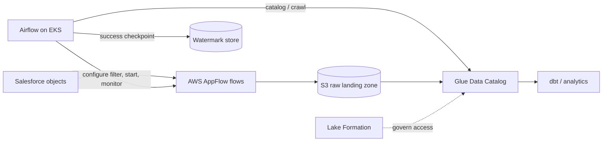

# Salesforce DataOps Platform

> Portfolio reference architecture for governed Salesforce ingestion with AWS AppFlow, Apache Airflow on Amazon EKS, and a lakehouse landing zone.

This repository presents a production-minded design for moving Salesforce data into an AWS data platform. It focuses on the operational patterns that make ingestion dependable: infrastructure as code, incremental extraction, controlled backfills, isolated retries, cataloging, governance, and observable orchestration.

**Portfolio-safe by design:** examples use synthetic names and placeholder resources. This repository does not contain production credentials, account identifiers, customer records, or deployment-specific configuration. It is an architecture and implementation guide, not a deployable copy of a production environment.

## At a glance

- **Source:** Salesforce standard and custom objects.
- **Extraction:** AWS AppFlow flows provisioned as code and triggered on demand.
- **Orchestration:** Apache Airflow on EKS coordinates flow groups, individual runs, retries, and downstream tasks.
- **Incremental state:** a durable watermark per flow, advanced only after a successful extraction and landing.
- **Landing and discovery:** Amazon S3, AWS Glue Data Catalog, and Lake Formation permissions.
- **Analytics hand-off:** downstream transformation jobs (for example, dbt) run only after ingestion and catalog steps succeed.



## What this demonstrates

| DataOps capability | Design evidence |
| --- | --- |
| Repeatable infrastructure | CDK-style flow and governance resources, configured per object |
| Reliable incremental loads | Object-appropriate timestamp filters and persisted watermarks |
| Safe recovery | Single-flow reruns, bounded backfills, and checkpoint control |
| Scalable orchestration | Parallel flow groups with a master DAG and isolated execution |
| Data discoverability | S3 landing conventions and Glue catalog integration |
| Governed access | Least-privilege roles and Lake Formation permissions |
| Operational ownership | Runbook, failure handling, observability, and security guidance |

## Documentation

- [Architecture and design](docs/architecture.md)
- [Use cases](docs/use-cases.md)
- [Operations runbook](docs/operations-runbook.md)
- [Security and governance](docs/security-and-governance.md)
- [Synthetic flow catalog example](examples/flow-catalog.example.yaml)

## Repository map

```text
.
├── docs/
│   ├── architecture.md
│   ├── operations-runbook.md
│   ├── security-and-governance.md
│   └── use-cases.md
└── examples/
    └── flow-catalog.example.yaml
```

## How a run works

1. Airflow resolves the requested flow and extraction mode (incremental, full, or bounded backfill).
2. The orchestration layer reads the last successful watermark and configures the AppFlow filter for the run.
3. AppFlow extracts the selected Salesforce object and writes to the configured S3 landing prefix.
4. Airflow monitors the flow to a terminal state; unsuccessful runs fail visibly and do not advance the watermark.
5. On success, the pipeline catalogs or crawls the landed data and commits the new watermark.
6. Group-level orchestration may start downstream transformations after all required ingestion groups succeed.

The detailed sequence, failure behavior, and backfill safeguards are in the [architecture](docs/architecture.md) and [runbook](docs/operations-runbook.md).

## Example scenarios

- Onboard a new Salesforce object with an explicit field allowlist.
- Run regular incremental ingestion using `LastModifiedDate` or `CreatedDate`, as appropriate.
- Re-run one failed flow without replaying the complete estate.
- Backfill a large historical object in bounded windows without corrupting the steady-state watermark.
- Trigger downstream models only after ingestion and cataloging are complete.

See [use cases](docs/use-cases.md) for assumptions and acceptance criteria.

## Scope and next implementation steps

This portfolio repository documents architecture and operational contracts; its YAML file is an illustrative catalog, not an executable CDK or Airflow deployment. To turn the design into a runnable reference implementation, add a CDK app with parameterized resources, a tested Airflow DAG/operator, and sandbox integration tests. Deploy only in an authorized non-production AWS account with a Salesforce sandbox connection profile.

## Safety note

Do not add real Salesforce exports, OAuth tokens, connector-profile names, account IDs, internal bucket names, IAM principal ARNs, or production endpoints. Use synthetic data and placeholders in any future examples.
