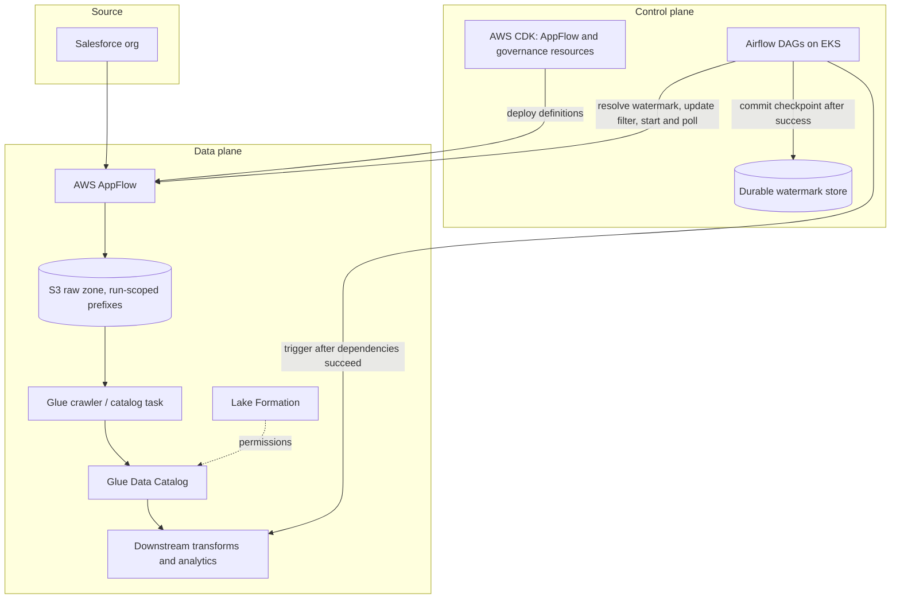

# Architecture and design

## Goals

The platform makes Salesforce ingestion repeatable, restartable, and governable. AWS AppFlow handles source-to-cloud data movement; Airflow on EKS owns orchestration and operational controls; AWS-native lake services provide landing, discovery, and access governance.

The design separates **flow definition** from **run state**. Infrastructure code describes the Salesforce object, destination, selected fields, connector profile reference, and optional filter task. Airflow supplies run-time filter values and manages orchestration state.

## Logical architecture

## Component responsibilities

| Component | Responsibility |
| --- | --- |
| CDK application | Define reusable flow resources and object-specific configuration; apply consistent destination and governance conventions. |
| AppFlow | Authenticate through a preconfigured Salesforce connector profile, extract one object, and deliver files to S3. |
| Airflow on EKS | Resolve run parameters, prepare incremental filters, start and monitor flows, retry tasks, group flows, and control downstream dependencies. |
| Watermark store | Keep the last successfully committed extraction boundary per flow, independently of transient task state. |
| S3 | Retain raw extracted files under predictable object/run prefixes for replay and downstream processing. |
| Glue | Make landed data discoverable for query and transformation workloads. |
| Lake Formation | Enforce data access grants independently of orchestration. |
| Downstream transforms | Consume cataloged data only after upstream tasks satisfy their dependencies. |

## Extraction lifecycle

1. **Deploy:** CDK creates on-demand AppFlow flows from validated per-object configuration. The Salesforce connector profile and execution role are provisioned and authorized separately.
2. **Resolve mode:** Airflow validates the requested flow and resolves the run as incremental, forced full, or bounded backfill. Invalid flow names and invalid parameter combinations fail before extraction.
3. **Choose a filter field:** Use an update timestamp such as `LastModifiedDate` for mutable objects. Use a creation timestamp such as `CreatedDate` for append-only or history-like objects that do not expose a suitable update timestamp.
4. **Prepare the run:** For an incremental run, Airflow obtains the last committed boundary and updates the AppFlow filter before starting the flow. A first run follows an explicit full-load or configured lookback policy; it must not silently choose an unsafe extraction window.
5. **Extract and monitor:** AppFlow writes to an S3 prefix scoped by object and execution. Airflow waits for a terminal state and surfaces an AppFlow error as a failed task.
6. **Catalog and commit:** After successful extraction (and required cataloging), Airflow commits the new watermark. Failed runs never move the watermark forward.
7. **Continue:** A group orchestrator can run independent object groups in parallel, then trigger downstream transformations only when the required groups succeed.

## Watermark and backfill semantics

- Store watermarks per flow, not as one global timestamp.
- Treat a watermark as a **commit marker**: persist it only after the extraction and required landing/catalog checks have succeeded.
- Prefer a small configurable overlap/lookback when source timestamp precision or delayed visibility could otherwise create gaps; make downstream deduplication strategy explicit.
- For a bounded backfill, use a lower-inclusive and upper-exclusive interval (`[start, end)`). Keep steady-state watermark writes disabled during each chunk.
- After every chunk succeeds and the expected ranges are reconciled, commit the final checkpoint once. A failed chunk is retried or repaired without falsely marking later data as complete.
- A forced full load is an explicit operator action, not an automatic fallback for a missing watermark on a high-volume object.

## S3 and schema conventions

Use a stable logical layout such as `salesforce/<object>/run_id=<execution-id>/`. Keep the original extracted files immutable; record extraction time and flow identity in run metadata. A Glue crawler or controlled schema-registration task can publish the files to the catalog. For production, choose file format, partitioning, retention, and schema evolution rules from measured workload requirements rather than hard-coding them in the example.

The example catalog is intentionally synthetic. Field allowlists should be reviewed with data owners, and unsupported or sensitive fields should not be exported by default.

## Reliability and scaling

- Limit concurrent runs per flow to prevent overlapping updates to the same AppFlow definition or watermark.
- Use bounded polling intervals and timeouts for asynchronous flow execution.
- Retry transient orchestration or AWS API errors with backoff; fail fast on invalid configuration and authorization errors.
- Isolate independent objects into groups so one object failure does not force an unnecessary replay of every flow.
- Use run-scoped landing prefixes and deterministic flow identifiers to aid reconciliation and replay.
- Size Airflow workers and Kubernetes pods for orchestration needs; the bulk transfer itself is performed by AppFlow.

## Adjacent ingestion pattern

A separate file-based Salesforce export path can ingest files from a managed object store such as Azure Blob into S3 using a Kubernetes pod task, followed by an S3 sync. That pattern is useful when the source arrives as exported files, but it is **not the same pipeline** as direct Salesforce-to-S3 AppFlow extraction and should have separate ownership, credentials, data contracts, and monitoring.

## Design trade-offs

- **On-demand flows vs scheduled AppFlow:** Airflow provides shared retries, orchestration, run parameters, and downstream dependencies; it also means the Airflow platform is part of the ingestion control plane.
- **One flow per object vs a monolith:** Per-object flows improve isolation and configuration clarity, with more resources to catalog and govern.
- **Watermark in a durable store vs task-local state:** A durable store supports restarts and single-flow operations; writes must be carefully ordered after successful work.
- **Raw landing vs transform-on-ingest:** Immutable raw files improve replayability and traceability but require lifecycle and storage-cost policies.
